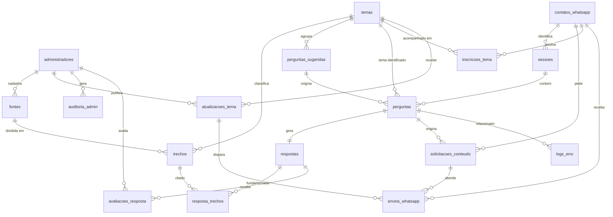

# Banco de dados — Oráculo dos Direitos Trabalhistas

PostgreSQL 16 + **pgvector**. Um banco só guarda os dados da aplicação e também os embeddings do RAG, então não é preciso um banco vetorial separado.

| Arquivo | Conteúdo |
|---|---|
| `01_schema.sql` | Tabelas, índices, views, funções e triggers |
| `02_seed.sql` | Admin de desenvolvimento, temas, perguntas sugeridas e a cartilha do TRT4 |
| `docker-compose.yml` | Sobe o banco já com os dois scripts aplicados |

## Como rodar

```bash
cd database
docker compose up -d
# conectar: psql -h localhost -U oraculo -d oraculo   (senha: oraculo_dev)
```

Sem Docker, use um PostgreSQL com pgvector instalado e rode `01_schema.sql` e depois `02_seed.sql`.

## Diagrama ER



## Tabelas por módulo

**Base de conhecimento (RF02, RF04, RF07, RF08, UC07)**
- `fontes`: documentos de referência, como a cartilha do TRT4, com link para o original.
- `trechos`: pedaços (chunks) de cada fonte com o `embedding vector(1536)`. O índice HNSW é usado na busca por similaridade e o índice GIN na busca textual em português.
- `temas` e `perguntas_sugeridas`: o que aparece na página inicial.

**Consultas (RF01, RF03, RF05–RF09, UC01–UC03)**
- `sessoes`: o usuário não cria conta (RF01). A sessão é um UUID anônimo.
- `perguntas` → `respostas` (1:1). Quando o RAG não encontra nada relevante, a resposta é gravada com `status = 'SEM_INFORMACAO'` (RF09).
- `resposta_trechos`: quais trechos fundamentaram a resposta e com qual similaridade. Isso atende RF07 e RF08.
- `avaliacoes_resposta`: feedback do usuário ou avaliação da equipe (PB12, RNF08).

**WhatsApp (RF10–RF13, UC04–UC06)**
- `contatos_whatsapp`: telefone no formato E.164, com **consentimento obrigatório** e opt-out (LGPD).
- `solicitacoes_conteudo`: pedido de material complementar.
- `inscricoes_tema`: temas que o contato acompanha. Só pode existir uma inscrição ativa por tema.
- `atualizacoes_tema`: quando uma atualização é publicada, um trigger já enfileira as mensagens em `envios_whatsapp` para todos os inscritos ativos. O **n8n** só precisa ler a fila (`status = 'PENDENTE'`), enviar e atualizar o status.

**Admin e observabilidade (RF14, RNF04, RNF06, UC08)**
- `administradores`: senha guardada só como hash bcrypt.
- `auditoria_admin`: histórico do que cada admin alterou.
- `logs_erro`: erros da API, do RAG, da LLM, do n8n e do WhatsApp.

## Views e funções prontas

| Nome | Para quê |
|---|---|
| `fn_buscar_trechos(embedding, k, sim_min, tema)` | Busca do RAG: retorna os *k* trechos mais similares |
| `vw_fontes_resposta` | Fontes de uma resposta, prontas para o front (RF07/RF08) |
| `vw_auditoria_perguntas` | UC08: perguntas e respostas **sem** dados pessoais (LGPD) |
| `vw_metricas_diarias` | Volume, % sem informação, tempo médio e custo da IA por dia (RNF05/RNF09) |
| `vw_inscritos_ativos` | Contatos que podem receber atualizações |

## Fluxo de uma pergunta

1. O front cria ou reutiliza uma `sessoes` e insere a pergunta em `perguntas`.
2. O backend gera o embedding da pergunta e chama `fn_buscar_trechos(...)`.
3. Se não vier nenhum trecho acima do limiar, grava `respostas.status = 'SEM_INFORMACAO'`.
4. Se vierem trechos, envia-os à LLM, grava a resposta com tokens, custo e tempo, e grava os trechos usados em `resposta_trechos`.
5. O front mostra a resposta e as fontes a partir de `vw_fontes_resposta`.

## Observações

- A dimensão `vector(1536)` corresponde ao `text-embedding-3-small`. Se usarem outro modelo de embedding, troquem o número em `trechos`, em `perguntas` e em `fn_buscar_trechos`.
- Troquem a senha do admin do seed antes de qualquer deploy.
